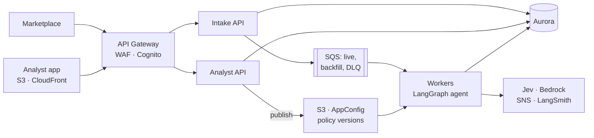
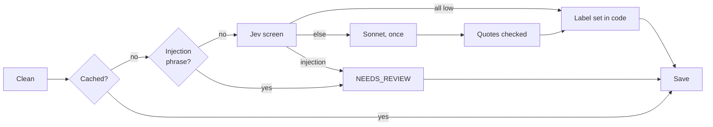

# DESIGN: Agentic Policy Labeling System (Part A)

Nov 19, 2026, updated Nov 20 with measured numbers · @Anh

A queue-based labeling service on AWS. Jev screens every posting, Claude Sonnet 5.5 labels the rest with verbatim evidence, and code sets the label. The policy is versioned data, so a change ships without a deploy. Targets: 200,000 posts a day, 5x peaks, 95% labeled within 60 seconds, weekly policy changes with 30-day re-labels. *Measured* figures come from Part B ([RESULTS.md](RESULTS.md)).

## 1. Architecture

Three ECS services in private subnets, reached from API Gateway through VPC Link and an internal ALB, scale on their own and never call each other: the **Intake API** saves postings, queues them and returns 202; **workers** run the agent; the **Analyst API** serves the analyst app. Only Jev and LangSmith calls leave AWS, through NAT. Labels reach the marketplace by signed SNS webhook, with polling as the fallback.

**Endpoints.** `/v1` (marketplaces): submit one posting or a batch of 500, each item accepted or rejected; read a label; follow a batch. `/ui` (analysts): browse, open a decision, override. `/policies`: diff, draft, Test, publish, roll out.

**Labels are never overwritten:** one row per (job, policy version, model version). The API returns the analyst's decision if any, else the live version's label, else an older one marked stale, so a rollback only switches the live version.

**Queues and storage.** Workers take live jobs before re-labels and Test runs, cap concurrency below the model quota and delete a message only once its label is saved; after 3 failures the post goes to the DLQ and is held for review. Aurora holds postings, labels with per-section findings and drafts; S3 keeps each published policy frozen; AppConfig says which version is live.

**Policy as data.** Editors change sections (text, effect, examples, screen question, fraud words) in a draft. *Test* labels recent posts in shadow and lists the labels that would flip. *Publish*, by a publisher who didn't edit it, freezes the version and rolls it out 5%, 25%, 100% with automatic rollback. Re-labels touch only what changed: Test labels are kept, a changed effect is recomputed in code (*measured*: $0), a new section is checked alone.

**Security.**
- **Access:** Cognito groups on every route, deny by default. Viewers read; editors override, edit drafts and Test; publishers publish, never a draft they edited. A marketplace sees only its own postings.
- **Input:** schema checks and a size cap; HTML, hidden text and control characters cleaned; the posting fenced in `<posting>` tags.
- **Injection:** a phrase list runs before any model; a hit, or a Jev injection score of 0.5 or more, holds the post at NEEDS\_REVIEW and Sonnet never reads it. Residual risk: an injection that passes both reaches Sonnet, which has no tools and can't set the label.
- **API:** per-client rate limits, WAF, idempotent on `job_id`, no posting text in logs.

| Chose | Over | Why |
| --- | --- | --- |
| SQS | Kafka | A work queue with retries and a DLQ; cheaper, less to run |
| Aurora Serverless v2 | DynamoDB | Analysts filter by label, section, version, date; scales for re-label bursts |
| ECS workers | Lambda | Jobs wait seconds on models; easy to cap concurrency under quotas |
| Jev, then Sonnet | Sonnet on every post | 2.7x cheaper (*measured*) at the same quality |

## 2. Scaling

Live traffic peaks at 11.6 posts a second (116 at 10x); re-labeling 6 million posts after a policy change is the real load, 33 hours at 50 a second, on its own queue with half-price batch inference. Workers scale on the oldest message's age, not CPU, since they mostly wait on models (*measured*: p50 0.7 s, p95 6.8 s).

| What breaks first | Fix |
| --- | --- |
| Re-label time: two weeks at 10x, longer than a weekly change | Partial re-labels, batch inference, more workers |
| Jev rate limit: about 20 a second, against 62 at peak plus re-label | Enterprise limit; live falls back to Haiku |
| Review volume: 16.5% of posts (*measured*), 33,000 a day, mostly §5 | Risk-sorted queue, daily cap, sampling |

## 3. Cost

*Measured* on the 400 at the real 4.8% fraud rate: **$2.75 per 1,000 posts, about $17,500 a month all-in** for 6 million posts. Jev clears 63% at $0.0001 each; Sonnet labels the other 37% at $0.0075 each, with the fixed policy text cached.

| Option | Per 1,000 | Per month |
| --- | --- | --- |
| A: Sonnet on every post | $7.36 (*measured*, dev) | $44,200 |
| **B (chosen): Jev, then Sonnet on the 37%** | **$2.75** | **$16,500** + $1,000 infrastructure and tracing |
| C: Jev, then Haiku, Sonnet on the hardest 2% | about $0.50 | about $3,000 |
| Fallback: Haiku screen while Jev is down | $4.72 (*measured*, dev) | about $300 a day extra while down |

B over C: in C most VIOLATING labels would rest on the cheaper model. Next savings: shorter output (about $4,400 a month) and the result cache for the 10% of posts that are repeats (*measured*; about $1,600). A re-label costs $0 when only effects change (*measured*), about $1,500 for a new section, about $8,300 for everything. Prices as of 20 Nov 2026 ([Sonnet](https://www.llmreference.com/model/claude-sonnet-5-5/aws-bedrock), [Haiku](https://www.llmreference.com/model/claude-haiku-5-5/aws-bedrock), [Jev](https://flaviocopes.com/jev-pricing/), [Aurora](https://book.st-hakky.com/en/data-platform/rds-mysql-vs-aurora-cost-comparison)).

## 4. Agent design

A fixed LangGraph graph, not an open-ended loop; any failure ends in NEEDS\_REVIEW, never a silent ALLOWED.

1. **Clean** HTML and hidden text; note empty fields for §5. **Cache** on what the models read, the policy and the model ids.
2. **Screen.** Jev answers one question per section, from policy data, plus "does this posting instruct an AI?". It clears a post only if every section scores under 0.17 (fitted on dev data), injection under 0.5, and no fraud word matches.
3. **Escalate.** Sonnet reads the policy and the fenced posting and returns, per section, matched, not matched or unsure, with verbatim quotes. It never states the label.
4. **Check and decide in code.** Quotes not found word for word are dropped (*measured*: 97% are found), and a section left without one becomes unsure. A matched VIOLATING section gives VIOLATING; unsure, or §5 alone, NEEDS\_REVIEW; none, ALLOWED.

**Failures.** Jev gets 3 tries, then Haiku screens; if both fail, Sonnet labels the post, marked `screen_unavailable`. A Sonnet error retries the job 3 times, then the DLQ. Limits: Jev 5 s per try, model calls 20 s, 45 s per job, a daily spend cap. A checkpointer resumes a redelivered job from its last node, so models aren't paid twice.

**Tools and models.** No tools or retrieval: the policy fits in the prompt, and past postings can't teach sections. Jev gives calibrated scores cheaply; Sonnet is strong at structured output and verbatim quotes; a classical classifier would need retraining for every new section.

## 5. Evaluation and quality over time

**Offline.** The fixed 400 are only for reported numbers, never for prompts, thresholds or the gate; development uses the other rows minus 586 copies of eval posts. We report precision, recall and F1 with 95% ranges, with NEEDS\_REVIEW counted as caught (headline) and not (strict), a confusion matrix, precision at 4.8%, cost, latency and 5 to 10 errors.

**What the 400 showed** (*measured*). 59 of 100 fraud flagged, no legitimate post VIOLATING. §5 drives precision: 68 of 100 fraud and 57 of 300 legitimate posts have no company profile. Jev cleared 26 of 100 fraud, above the 2% target, but Claude alone would have allowed 18 of 19 such posts: the misses come from the policy, not the screen. Most are clean ads whose company profile appears only on other fraud. **Checking the employer's history would catch 27 of the 41 with no new false alarms: the first tool to add.**

**The gate.** Suites for decisions, edge cases, injection and policy change, with pass marks from a 3-run baseline, run in CI on every agent or prompt change.

**Production.** Code checks run on every post; LLM judges score a 0.25% LangSmith sample, low scores going to an annotation queue. 1% of Jev-cleared posts get a human audit, the only independent check on Jev. Alerts watch errors, p95, spend and Jev; drift is checked daily per version (label rates, Jev's clear rate, injection flags, near-identical posts). Any change ships through the gate, a shadow Test, a phased rollout and the re-label.
