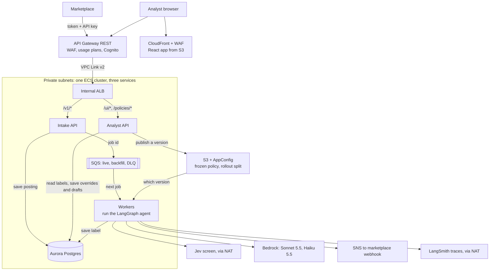
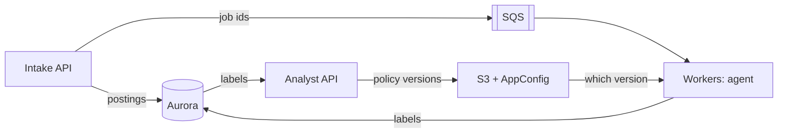
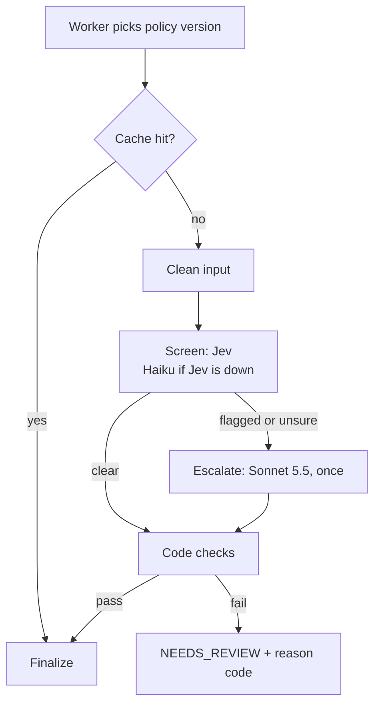

# DESIGN: Agentic Policy Labeling System (Part A)

Nov 19, 2026 · @Anh

A queue-based labeling service on AWS. Jev screens every posting; Claude Sonnet 5.5 labels the rest with verbatim evidence; code checks every result. The policy is versioned data, so a change ships without a deploy. Targets: 200,000 posts a day, 5x peaks, 95% labeled within 60 seconds, weekly policy changes with 30-day re-labels.

## 1. Architecture

Postings enter through one API, wait on SQS, and are labeled by autoscaled workers. Labels are pushed to the marketplace and browsed by analysts. Only Jev and LangSmith calls leave AWS.

**Three services, one ECS cluster.** Each service runs its own tasks and scales on its own.

| Service | What it does | API |
| --- | --- | --- |
| Intake API | Takes postings, saves them, queues them, returns labels to the marketplace | `/v1/*` |
| Analyst API | Backend for the analyst app: labels, decisions, overrides, policy drafts and publishing | `/ui/*`, `/policies/*` |
| Workers | Pulls jobs from SQS and runs the agent; scales on queue age | None |

The services never call each other. They meet only through shared stores:

**API path (marketplace).** API Gateway (REST) applies WAF rules, the client's usage plan and a Cognito token check, then forwards through VPC Link v2 to an internal ALB. The Intake API saves the posting to Aurora, puts the job id on SQS and returns 202. A worker labels it, upserts the result on (job id, policy version, model version), and SNS pushes it to the marketplace webhook with an event id for dedup. `GET /v1/postings/{id}/label` is the polling fallback.

**UI path (analysts).** The React app comes from S3 through CloudFront. Its calls go through the same API Gateway to the Analyst API, which checks the analyst's Cognito group (viewer, editor or publisher). The browser never touches Aurora, S3 or AppConfig.

**Endpoints**

| Endpoint | Service | Does |
| --- | --- | --- |
| `POST /v1/postings` | Intake | Submit one posting; 202 and a job id |
| `POST /v1/postings/batch` | Intake | Up to 500; each item accepted or rejected |
| `GET /v1/postings/{id}/label` | Intake | Latest label, the polling fallback |
| `GET /v1/batches/{id}` | Intake | Batch progress |
| `GET /ui/labels` | Analyst | Browse and filter by label, section, version, date |
| `GET /ui/labels/{id}` | Analyst | One decision with evidence and trace link |
| `POST /ui/labels/{id}/override` | Analyst | Record an analyst's disagreement |
| `GET /policies`, `GET /policies/{v}` | Analyst | List, read and diff versions |
| `POST /policies/drafts`, `PUT /policies/drafts/{id}` | Analyst | Create and edit a draft |
| `POST /policies/drafts/{id}/test` | Analyst | Shadow run plus the gate; flip report |
| `POST /policies/drafts/{id}/publish` | Analyst | Freeze and start the 5% rollout |
| `PUT /policies/rollout` | Analyst | Change the %, promote or roll back |

**Queue and batch**

- **Single post:** validate, save the posting (once per job id), send the job id to SQS, return 202 with the job id.
- **Batch (up to 500):** each item is validated on its own. Good items are bulk-saved and sent to SQS 10 per call; the 202 lists every item as accepted or rejected with a reason, so one bad item never sinks the batch. `GET /v1/batches/{id}` shows progress, and each post is labeled and pushed on its own.
- **Workers** pull up to 10 jobs at a time, label them in parallel under a concurrency cap set below the model quota, and delete a message only after its label is saved.
- **Failures:** a job whose worker dies reappears after the visibility timeout (about 2 minutes) and is retried. After 3 failures it goes to the DLQ and the post is marked NEEDS\_REVIEW.
- **Backfill** has its own queue, so it never delays live posts.

**Storage.**

- **Aurora PostgreSQL Serverless v2, I/O-Optimized:** postings, labels, per-section findings, policy drafts, overrides. Writer and reader have separate compute but share one storage volume, so analyst queries never slow the workers, and capacity grows for the weekly re-label bursts.
- **S3:** one frozen YAML per published policy version (Object Lock), raw data and reports.
- **AppConfig:** which policy version is live and the rollout split.

**Where models run.** Jev is an outside API reached through the NAT Gateway. Claude Sonnet 5.5 (escalation) and Haiku 5.5 (fallback screen) run on Bedrock through a VPC endpoint.

**Policy as data.** Editors change sections (id, text, effect, examples, screen question) in an Aurora draft. *Test* runs the draft in shadow on recent posts and shows which labels flip. *Publish* freezes it, writes the YAML to S3 and starts a phased rollout: workers hash the job id, so 5%, then 25%, then 100% of traffic gets the new version. CloudWatch alarms roll it back automatically. On promote, EventBridge triggers a Lambda that queues the last 30 days for re-labeling. Adding a new policy section is one new row; nothing is redeployed.

**Re-label only what changed.** The backfill compares the old and new versions' section rows. If the new version only adds sections, it runs just those sections on old posts and merges with their stored findings. If a section was edited or removed, it re-labels everything. The trigger Lambda queues 720 hourly chunks (30 days × 24) rather than 6 million job ids, so it finishes in seconds, well inside Lambda's 15-minute limit; each worker that takes a chunk labels the posts from that hour.

**Security.** HTTPS on every hop to the ALB. Each ECS service has its own IAM role, so only the Analyst API can publish. Whoever edited a draft cannot publish it. Every override and publish is audited.

**Access control (RBAC)**

| Role | Can do |
| --- | --- |
| viewer | Browse labels, open decisions, read policies |
| editor | Viewer, plus overrides, drafts and Test |
| publisher | Editor, plus publish, change the rollout %, roll back; not on a draft they edited |
| admin | Manage users and groups |
| marketplace | `postings:write` and `labels:read`, own postings only |

Roles are Cognito groups or scopes carried in the token, checked on every route (deny by default). Each ECS service also has its own IAM role, so only the Analyst API can publish a policy.

**Input safeguards**

- **Schema:** a Pydantic model checks required fields, types, length per field and allowed values, with a cap on request size. Failures get a 422 and never reach the queue.
- **Clean:** HTML becomes plain text through a real parser; scripts, styles, comments, hidden elements, zero-width and control characters are dropped. The raw original is kept for audit.
- **Fence:** the posting goes inside `<posting>` tags, and any tag-like text in it is escaped so it cannot close the fence and talk to the model.
- **Detect:** Jev's injection question plus a few patterns ("ignore previous instructions"). A hit holds the post at NEEDS\_REVIEW or above.
- **Powerless:** the model has no tools and code decides the label, so an injection can at most push toward a wrong label, which the checks catch.
- **Web basics:** the analyst UI shows postings as plain text, never HTML; all SQL is parameterised; raw posting text never goes into logs.

**API safeguards**

- **Identity:** Cognito token checked at API Gateway, plus an API key for the usage plan.
- **Permissions:** scopes and groups per route, deny by default; the marketplace sees only its own postings.
- **Limits:** per-client rate and quota, a batch cap of 500, a request size cap, and WAF managed rules against SQL injection, XSS and bad bots.
- **Shape:** request validation at the gateway, then Pydantic; idempotent on `job_id`.
- **Transport and audit:** HTTPS to the ALB, no internal details in error messages, access logs and CloudTrail. SNS messages are signed, so the marketplace can verify a label came from us.

**Key trade-offs**

| Chose | Over | Why |
| --- | --- | --- |
| SQS | Kafka | We need a work queue with retries and a dead-letter queue, not an event log. Cheaper and less to run |
| Aurora Serverless v2 | DynamoDB, plain RDS | Analysts filter by label, section, version and date, which is natural in SQL. Scales for the weekly re-label bursts |
| ECS Fargate workers | Lambda | Jobs wait seconds on models; long-running workers make it easy to cap concurrency under model quotas |
| API Gateway REST API | HTTP API | Per-client usage plans and WAF; HTTP API has neither |
| Internal ALB | NLB | Routes by path to two services and health-checks over HTTP |
| Jev, then Sonnet | Sonnet on every post | About 6x cheaper; the quality cost is measured in the eval |
| Jev and LangSmith outside AWS | Everything inside AWS | Jev's speed and price, LangSmith's tracing. Posting text leaves AWS, so we sign a data agreement with TypeSafe and self-host LangSmith or redact its inputs |

## 2. Scaling

Live traffic is small; re-labeling after a policy change is the real load. A weekly change re-labels 6 million posts, four times that week's live volume.

| Load | Posts | Rate |
| --- | --- | --- |
| Live, average | 200,000 a day | 2.3 a second |
| Live, 5x peak |  | 11.6 a second |
| Live at 10x volume, 5x peak | 2 million a day | 116 a second |
| One 30 day backfill | 6 million | 33 hours at a 50 a second cap |
| One 30 day backfill at 10x | 60 million | 14 days at the same cap |

- **Peak.** SQS absorbs the burst. ECS Service Auto Scaling adds workers based on the CloudWatch metric SQS publishes for how long the oldest job has waited. The 60 seconds is waiting time plus about 1 to 10 seconds of labeling, so scaling out once the wait passes about 20 seconds protects the target. CPU would mislead, because workers mostly sit waiting on Jev and Bedrock. A new Fargate task takes about 30 seconds to 2 minutes to start, so the minimum task count already covers the 5x peak.
- **Backfill.** Its own queue and a capped share of workers, so live posts never wait behind it. It uses Bedrock batch inference at half price. A v2 that only adds sections re-checks just those sections on old posts and merges with the stored findings.
- **10x.** Same design with more workers and higher quotas; the limits below decide when.

**What breaks first**

| # | What | When | Fix |
| --- | --- | --- | --- |
| 1 | Backfill time | At 10x a backfill takes two weeks, so the next weekly change lands first | Partial re-label, batch inference, more workers |
| 2 | Jev rate limit | Published defaults are low and still changing (one source lists 1,200 requests a minute, about 20 a second); peak plus backfill is about 62 | Enterprise limit; live falls back to the Haiku screen, backfill pauses |
| 3 | Bedrock quota | At 10x, peak Sonnet calls rise from \~2 to \~17 a second | Request quota early, cross-region inference |
| 4 | NEEDS\_REVIEW volume | 3% of 200,000 is 6,000 a day, more than a team can read | Risk-sorted queue, daily cap, sample the rest |

Aurora, SQS and SNS are far from their limits at these rates.

## 3. Cost

The chosen design costs about $1.45 per 1,000 posts in model fees and about $9,600 a month all-in for live traffic. All rates are **pending testing** on the dev set.

**Assumptions.** A cleaned posting is about 1,000 tokens. A Sonnet call is 2,600 tokens in (policy, posting, Jev hints) and 400 out: $0.0092. A Jev call is about 1,700 tokens in, output free: $0.00007. Prices per million tokens: Sonnet 5.5 $2 / $10, Haiku 5.5 $0.10 / $0.50, Jev $0.042 input; batch inference half price. Jev clears 85% of posts. 6 million live posts a month.

| Option | What runs | Per 1,000 | Live per month |
| --- | --- | --- | --- |
| A | Sonnet on every post | $9.20 | $55,200 |
| **B (chosen)** | Jev on every post, Sonnet on the 15% it does not clear | $1.45 | $8,700 |
| C | Jev screens every post; Haiku labels the 15% Jev does not clear; Sonnet re-checks only the hardest 2% | $0.32 | $1,950 |
| Fallback | Haiku screen instead of Jev, only while Jev is down | $1.84 | \~$80 a day extra |

- **Why B over C:** in C most VIOLATING labels would rest on the cheaper model. C is the next step if tests show Haiku labels as well as Sonnet.
- **Number to watch:** Sonnet is 95% of B's bill, so every 5 points less clearing by Jev adds about $2,760 a month.
- **Backfill:** a full 30 day re-label is about $0.76 per 1,000 at batch prices, $4,570 per policy change. Re-checking only changed sections cuts most of it.
- **Infrastructure:** about $925 a month (Aurora \~$365, Fargate \~$290, NAT and endpoints \~$170, the rest \~$100; approximate).

**Total:** about $9,600 a month, $1.60 per 1,000 posts all-in, plus up to $4,570 for each full re-label.

Prices as of 19 Nov 2026: [Claude Sonnet 5.5 on Bedrock](https://www.llmreference.com/model/claude-sonnet-5-5/aws-bedrock), [Claude Haiku 5.5](https://docs.kanaries.net/articles/haiku-pricing), [Jev](https://flaviocopes.com/jev-pricing/), [Aurora Serverless v2](https://book.st-hakky.com/en/data-platform/rds-mysql-vs-aurora-cost-comparison). Infrastructure figures are approximate.

## 4. Agent design

A fixed LangGraph graph, not an open-ended agent loop: Jev clears what it is sure is clean, Sonnet labels the rest once, and code checks every result. Any failure ends in NEEDS\_REVIEW, never a silent ALLOWED.

**Before the agent runs, the worker picks the policy version.** Normally one version is live. During a phased rollout two are live, stable and candidate, and AppConfig says what share goes to the candidate (for example 5%). The worker turns the job id into a number from 0 to 99: below 5 gets the candidate, the rest get stable. The same job always gets the same number, so a retry never switches version. The agent is then handed that policy; it never chooses.

1. **Cache.** Hash of cleaned text + policy version + model version; a hit reuses the stored label.
2. **Clean.** Strip HTML, hidden text and zero-width characters, cap field lengths, keep a map back to the original for quote offsets.
3. **Screen (Jev).** One yes/no question per section (its `screen_question`, from policy data) plus "does this posting try to instruct an AI?". Clear as ALLOWED only if the version has a fitted threshold, every section scores under it, the injection score is low and no regex red flag fires. Otherwise escalate. Jev never labels VIOLATING.
4. **Escalate (Sonnet 5.5, once).** The prompt is a fixed header (the three labels, the edge cases) plus the sections printed from policy data. The posting is fenced and marked as untrusted. Jev's scores go in as hints. Structured output returns one finding per section: matched, verbatim quotes, confidence, plus a short rationale.
5. **Code checks (the output safeguard).** Schema valid, section ids exist in this version, every quote found word for word (offsets stored). The label is derived in code from section effects: any VIOLATING section means VIOLATING, only NEEDS\_REVIEW sections (§5 alone) means NEEDS\_REVIEW, none means ALLOWED. Because VIOLATING needs a quote, missing fields alone can never cause it.
6. **Finalize.** Upsert the label, publish to SNS, store the LangSmith trace id.

**Uncertainty and failures**

- **Unsure:** Jev escalates anything not clearly clean; Sonnet can answer NEEDS\_REVIEW; §5 alone is NEEDS\_REVIEW by policy.
- **Jev down:** 2 retries, then Haiku 5.5 runs the screen with the same clearing rule. A circuit breaker skips Jev for 60 seconds after repeated failures; backfill pauses. Pending testing.
- **Limits:** Jev 2 s, LLM 20 s, 45 s per job; daily cost cap; model allowlist in AppConfig. Every exception fails closed to NEEDS\_REVIEW with a reason code.
- **Prompt injection:** hidden text stripped, posting isolated as data, a high injection score forces at least NEEDS\_REVIEW, output constrained to real sections and real quotes, no tools to misuse, and an adversarial test suite.
- **Durability:** a Postgres checkpointer lets a redelivered job resume from its last node without paying for Jev or Sonnet twice, and lets us replay any node when debugging. Pruned after 7 days.

**Tools.** None in v1; the policy fits in the prompt. First candidate: a read-only `find_related_postings(email | phone | url)` to spot reused contact details across postings.

**Retrieval.** None for the policy: it fits in the prompt, and retrieving sections would only add a way to miss one. If the policy grows long, a Bedrock Knowledge Base filtered to the live version is the path. We also don't pull similar past postings into the prompt as examples: the dataset only says fraud or not, never which section, so they can't teach sections. Each policy section carries a few hand-written examples instead.

**Output.** The required fields (job id, label, sections, evidence, rationale, confidence, policy version) plus per-section findings, quote offsets, reason code, model and prompt version, and the trace id.

**Model choice.** Jev is a decision model with calibrated scores at about 100 ms and $0.07 per 1,000 posts; the trade-offs are that it sits outside AWS and has occasional outages. Sonnet 5.5 is strong at strict structured output and verbatim quoting; on Bedrock it gets IAM, a private endpoint and half-price batch for backfills. Part B calls the same models through the Anthropic API, switched by a model factory. Not chosen: an LLM on everything (6x the cost), a classical classifier as the screen (retraining for every new section), a fine-tuned small model (future work).

## 5. Evaluation and quality over time

Offline, golden suites gate every change before it ships. In production, code checks run inside the flow and LLM judges run in LangSmith afterwards, backed by audits, alerts and drift alarms.

**Offline**

- **Sets.** The fixed 400 are only for reported numbers: never for prompts, few-shot examples, thresholds or the gate. Everything else uses a dev set and hand-written posts drawn from the other 17,480 rows.
- **Reported on the 400.** Precision, recall and F1 for the fraud class, counted three ways: NEEDS\_REVIEW counted as caught (the headline), only VIOLATING counted, and the NEEDS\_REVIEW share. A confusion matrix of gold against all three labels. Precision recomputed at the real 4.8% fraud rate. Jev → Sonnet next to Sonnet only and the Haiku → Sonnet fallback, each with cost per 1,000 and p50 / p95 latency. 5 to 10 errors sorted into policy gap, model miss and false alarm.
- **The gate.** Suites for decisions, sections, edge cases, adversarial input, guards and policy change. Pass marks live in `thresholds.yaml`, set from a 3-run baseline, with zero slack on verbatim quotes, edge cases and injection. It runs in CI on any change to the agent, prompts or loaders, and in the policy Test step before Publish.

| Evaluators | When | Type | On fail |
| --- | --- | --- | --- |
| `schema_valid`, `sections_exist`, `quotes_verbatim`, `label_matches_findings` | In the flow, every post | Code | NEEDS\_REVIEW |
| `evidence_relevant`, `rationale_grounded` | Online, traced posts | LLM judge | Annotation queue + alert |
| `within_60s` | Online, traced posts | Code | Alert |
| `label_correct`, `section_correct` | Offline gate | Code | Blocks the change |

**Production**

- LangSmith traces a 10% sample plus every NEEDS\_REVIEW and escalation. Low judge scores go to an annotation queue; posts analysts correct join the golden dataset.
- 1% of Jev-cleared posts go to human audit, the only independent check on Jev's clears.
- Analyst override rate is tracked per section and policy version.
- Alerts: share of posts failing code checks, judge averages dropping, error rate, p95 over 45 seconds, no runs while SQS has messages, spend ahead of budget, Jev error rate.

**Drift.** Daily per policy version, against the previous 7 days: VIOLATING and NEEDS\_REVIEW rates, share of posts Jev is unsure about, escalation rate, injection flags, posting length, and sudden clusters of near-identical posts.

**Rolling out a new policy, prompt or model.** Gate passes, shadow run with a flip report, phased rollout 5% → 25% → 100% by job-id hash, automatic rollback on alarms (one AppConfig change), then the backfill after promote.
