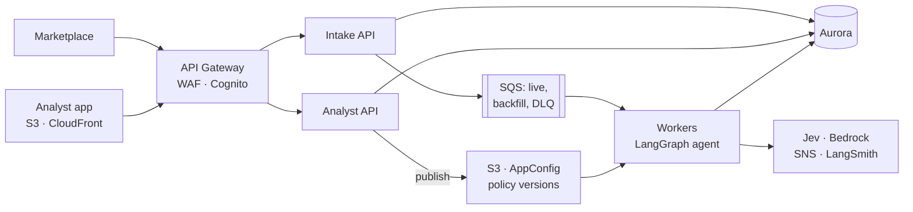
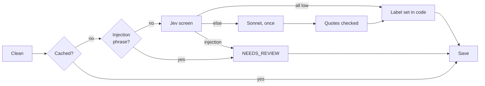

# DESIGN: Agentic Policy Labeling System (Part A)

Nov 19, 2026, updated Nov 20 with measured numbers · @Anh

A queue-based labeling service on AWS: Jev screens every posting, Claude Sonnet 5.5 labels the rest with verbatim evidence, code sets the label, and the policy is versioned data. Targets: 200,000 posts a day, 5x peaks, 95% labeled within 60 seconds, weekly policy changes with 30-day re-labels. *Measured* figures come from Part B ([RESULTS.md](RESULTS.md)).

## 1. Architecture

Three ECS services in private subnets, reached from API Gateway through VPC Link and an internal ALB, scale on their own and never call each other: the **Intake API** saves postings, queues them and returns 202; **workers** run the agent; the **Analyst API** serves the analyst app. Only Jev and LangSmith calls leave AWS, through NAT. Labels reach the marketplace by signed SNS webhook, with polling as the fallback.

**Endpoints.** `/v1` for marketplaces (submit one or a batch of 500, read a label), `/ui` for analysts (browse, inspect, override), `/policies` (draft, Test, publish, roll out).

**Labels are never overwritten:** one row per job, policy version and model version, so a rollback only switches the live version. An analyst's decision always wins.

**Queues and storage.** Live jobs go before re-labels and Test runs. Aurora holds postings, labels and drafts; S3 keeps each published policy frozen; AppConfig says which is live.

**Policy as data.** Editors change sections in a draft. *Test* labels recent posts in shadow and lists the labels that would flip. *Publish*, by a publisher who didn't edit it, freezes the version and rolls it out 5%, 25%, 100% with automatic rollback.

**Security.**

- **Access:** Cognito groups on every route, deny by default. Viewers read; editors override, edit drafts and Test; publishers publish, never a draft they edited. A marketplace sees only its own postings.
- **Input and API:** schema checks, size caps, per-client rate limits and WAF; postings cleaned and fenced in `<posting>` tags; injections held before Sonnet reads them (section 4); no posting text in logs.

| Chose                | Over                 | Why                                                                          |
| -------------------- | -------------------- | ---------------------------------------------------------------------------- |
| SQS                  | Kafka                | A work queue with retries and a DLQ; cheaper, less to run                    |
| Aurora Serverless v2 | DynamoDB             | Analysts filter by label, section, version, date; scales for re-label bursts |
| ECS workers          | Lambda               | Jobs wait seconds on models; easy to cap concurrency under quotas            |
| Jev, then Sonnet     | Sonnet on every post | 2.7x cheaper (*measured*) at the same quality                                |

## 2. Scaling

Live traffic peaks at 11.6 posts a second (116 at 10x). The real load is re-labeling 6 million posts after a policy change: 33 hours at 50 a second, on its own queue at batch prices. Workers scale on queue age, not CPU (*measured*: p50 0.7 s, p95 6.8 s).

| What breaks first                                                   | Fix                                              |
| ------------------------------------------------------------------- | ------------------------------------------------ |
| Re-label time: two weeks at 10x, longer than a weekly change        | Partial re-labels, batch inference, more workers |
| Jev rate limit: about 20 a second, against 62 at peak plus re-label | Enterprise limit; live falls back to Haiku       |
| Review volume: 16.5% of posts (*measured*), 33,000 a day, mostly §5 | Risk-sorted queue, daily cap, sampling           |

## 3. Cost

The chosen design costs about **$17,500 a month ($2.92 per 1,000 posts) as is**, and about **$13,100 ($2.18 per 1,000) with shorter output**. Model fees are *measured* on the held-out set and reweighted to the real 4.8% fraud rate.

**Assumptions.** 6 million live posts a month. Jev clears 63% of posts (*measured*) at about $0.0001 each; Sonnet labels the other 37% at $0.0075 each (*measured*, with prompt caching on). Prices per million tokens: Sonnet 5.5 $2 in / $10 out (cache reads $0.10), Haiku 5.5 $0.10 / $0.50, Jev $0.042 in; batch inference half price.

**Options compared** (model fees per 1,000 posts). **A, Sonnet on every post:** $7.36 (*measured*), $44,200 a month. **B, chosen:** Jev on every post and Sonnet on the 37% it doesn't clear, $2.75 (*measured*), $16,500 a month. **C:** Jev, then Haiku, with Sonnet re-checking only the hardest 2%, about $0.50; but most VIOLATING labels would rest on the cheaper model, so it's the next step only if tests show Haiku labels as well as Sonnet. **Fallback:** a Haiku screen while Jev is down, $4.72 (*measured*), about $300 a day extra.

**Monthly total:** model fees $16,500, infrastructure about $925 (Aurora \~$365, Fargate \~$290, NAT and endpoints \~$170, the rest \~$100) and LangSmith about $90 (1 seat, \~0.25% of posts traced, capped at $100): **about $17,500 as is, $13,100 with shorter output** (below).

**Ways to cut cost.** **Prompt caching** is already on: the policy goes before the posting, so every post reuses it at a twentieth of the input price, about $6,300 a month saved. Next, **shorter output** (only matched sections, a capped rationale) saves about $4,400; a **result cache** for the 10% of posts that repeat about $1,600 once measured on live traffic; and **more Jev clearing**, about $2,200 per 5 points, only if recall holds. Infrastructure cuts would save under 6% and cost Jev access or burst scaling, so we keep it.

**Re-label cost per policy change** (6 million posts, batch prices). Changing only what a section leads to costs **$0** (*measured*): labels are recomputed in code from stored findings. Adding or editing a section costs about **$1,500**: only that section is re-asked. Changing the header or edge cases re-labels everything, about **$8,300**.

**LangSmith spend control:** a $100 monthly limit and a weekly cap on evaluator spend; tracing errors are ignored, so a limit never blocks labeling.

Prices as of 20 Nov 2026: [Claude Sonnet 5.5 on Bedrock](https://www.llmreference.com/model/claude-sonnet-5-5/aws-bedrock), [Claude Haiku 5.5 on Bedrock](https://www.llmreference.com/model/claude-haiku-5-5/aws-bedrock), [Jev](https://flaviocopes.com/jev-pricing/), [Aurora Serverless v2](https://book.st-hakky.com/en/data-platform/rds-mysql-vs-aurora-cost-comparison), [Fargate](https://www.usage.ai/blogs/ec2-vs-fargate/), [LangSmith](https://www.zenml.io/blog/langsmith-pricing), [prompt caching](https://platform.claude.com/en/docs/build-with-claude/prompt-caching). Infrastructure figures are approximate.

## 4. Agent design

A fixed LangGraph graph, not an open-ended loop.

**How it uses the policy**

- **Dynamic prompting:** every prompt is assembled at run time from the job's policy version, not static context.
- **Calibrated screening:** each section becomes one yes/no question for Jev, which returns a calibrated probability; posts skip Claude only when every score falls under a cut-off tuned on labeled data.
- **Prompt caching:** the policy goes first and the posting last, so the policy is cached once per version and each post pays only for its own text.
- **Outcomes as data:** each section declares what a match means; changing it re-labels old posts from stored answers, with no model call.
- **Zero-deploy updates:** a published version goes live on the workers' next job; only new or edited sections are re-asked on past posts.

**How it produces evidence.** Sonnet quotes the posting per section; code finds each quote word for word and stores its position for the UI to highlight, dropping any it can't find (*measured*: 97% are found). §5 can rest on a verified empty field, such as no company profile.

**Handling uncertainty**

- **Escalate unless sure:** the Jev cut-off is tuned so at most 2% of posts Claude would flag get cleared without it; anything else goes to Sonnet.
- **Unsure is an answer:** an unsure section sends the post to a person instead of forcing a guess.
- **Evidence or no verdict:** a section left without a verified quote becomes unsure, never VIOLATING.
- **Injection held, not judged:** a known phrase or a high Jev injection score sends the post to review unread.

**Handling failures**

- **Retries and time limits:** Jev 3 tries on server errors and rate limits; a failed Sonnet call retries the job with a wait, up to 3 attempts; 20 s per model call, 45 s per job.
- **Fallbacks:** Jev down, Haiku screens with the same questions; both down, Sonnet reads every post.
- **Fail closed:** after 3 failed attempts the post is held at NEEDS_REVIEW with a reason code, never ALLOWED.
- **Crash recovery:** each finished step is saved, so a redelivered job resumes without paying the models twice.

**Tools.** None in v1. The policy fits in the prompt, and a model with no tools gives an injection nothing to misuse. Tools come in only where the eval shows a gap, starting with `employer_history(company)`, since most missed fraud came from employers whose other postings are fraud (about two-thirds of the misses, [RESULTS.md](RESULTS.md)). Then `find_related_postings(email, phone, url)` for contact details reused across ads (scam rings), `check_domain(url)` for links that don't match the company or are brand new, and `lookup_company(name, country)` for employers missing from business registries. If the policy outgrows the prompt, `policy_sections(post)` would send only the sections Jev scores as likely. Every tool is read-only and called by the graph, not chosen by the model; its result enters the prompt as a fact, never a label, and a failed call just means no result.

## 5. Evaluation and quality over time

Quality is checked at three points: before a change ships, on every post, and after it is live.

**Before a change ships (offline)**

- **Three kinds of test data:** a held-out set (400 postings, 100 fraud) used only to report numbers, never to tune; a development set (300 postings) for tuning and comparing set-ups; hand-written cases (edge cases, prompt injections, policy changes) where the right label is known exactly.
- **Metrics:** precision, recall and F1 on the fraud class (not accuracy: only 5% are fraud). NEEDS_REVIEW counts as caught and, strictly, as missed; the review load is reported so recall can't be bought with reviews.
- **Release check in CI:** every change to the agent, a prompt or the policy reruns the hand-written cases, and a change that scores below its pass mark can't merge. Pass marks come from 3 baseline runs, since models vary a little, with no slack on verbatim quotes or injections. A provider outage means a rerun, not a failure.

**On every post (in the flow).** Deterministic code checks, fast and reliable: every section exists, every quote really appears in the posting, the label matches the findings. A failure sends the post to an analyst with the reason, never to ALLOWED.

**After shipping (online, in LangSmith).** Production has no answer key, so it relies on these signals:

- **Deterministic code checks** on every trace, so a failure that slips through still shows up.
- **LLM judges** on a small sample (about 0.25% of posts, capped at $100 a month): are the quotes relevant to the section, and does the rationale follow from them?
- **Human annotation and calibration:** special cases go to an annotation queue in LangSmith for a person to label: a random sample of posts Jev cleared without Claude (to check Jev's performance), and traces the LLM judges scored low. These labels calibrate Jev's labeling cut-off and injection confidence threshold (first tuned on labeled development data) and whether LLM judges agree with human judges.
- **Analyst corrections:** when an analyst changes the final label, we review the case to see whether the policy is missing something or it's the agent's performance issue.
- **Drift:** daily per policy version: label rates, how much Jev clears, injection flags.

**Alerts (LangSmith and CloudWatch, to Slack).** Quality: judge scores dropping, analyst corrections rising. System: errors, p95 over 45 s, a stalled queue, Jev failing, spend ahead of budget.