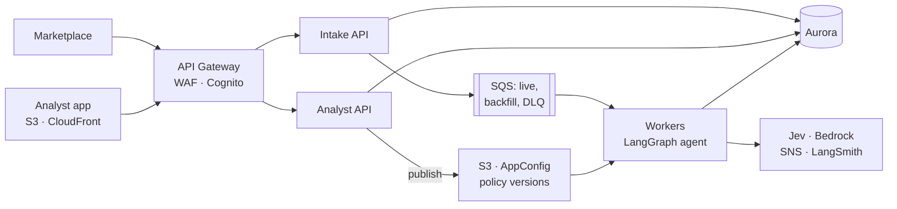
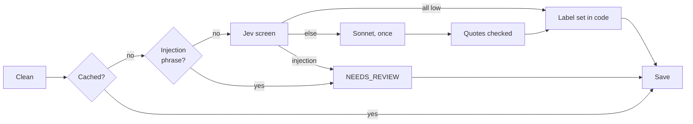

# DESIGN: Agentic Policy Labeling System (Part A)

Nov 19, 2026, updated Nov 20 with measured numbers · @Anh

A queue-based labeling service on AWS: Jev screens every posting, Claude Sonnet 5.5 labels the rest with verbatim evidence, code sets the label, and the policy is versioned data. Targets: 200,000 posts a day, 5x peaks, 95% labeled within 60 seconds, weekly policy changes with 30-day re-labels. *Measured* figures come from Part B ([RESULTS.md](RESULTS.md)).

## 1. Architecture

Three ECS services in private subnets, reached from API Gateway through VPC Link and an internal ALB, scale on their own and never call each other: the **Intake API** saves postings, queues them and returns 202; **workers** run the agent; the **Analyst API** serves the analyst app. Only Jev and LangSmith calls leave AWS, through NAT. Labels reach the marketplace by signed SNS webhook, with polling as the fallback.

**Endpoints.** `/v1` for marketplaces (submit one or a batch of 500, read a label), `/ui` for analysts (browse, inspect, override), `/policies` (draft, Test, publish, roll out).

**Labels are never overwritten:** one row per job, policy version and model version, so a rollback only switches the live version. An analyst's decision always wins.

**Queues and storage.** Live jobs go before re-labels and Test runs. Aurora holds postings, labels and drafts; S3 keeps each published policy frozen; AppConfig says which is live.

**Policy as data.** Editors change sections (text, effect, examples, screen question, fraud words) in a draft. *Test* labels recent posts in shadow and lists the labels that would flip. *Publish*, by a publisher who didn't edit it, freezes the version and rolls it out 5%, 25%, 100% with automatic rollback. Posts the Test labeled keep those labels.

**Security.**
- **Access:** Cognito groups on every route, deny by default. Viewers read; editors override, edit drafts and Test; publishers publish, never a draft they edited. A marketplace sees only its own postings.
- **Input and API:** schema checks, size caps, per-client rate limits and WAF; postings cleaned and fenced in `<posting>` tags; injections held before Sonnet reads them (section 4); no posting text in logs.

| Chose | Over | Why |
| --- | --- | --- |
| SQS | Kafka | A work queue with retries and a DLQ; cheaper, less to run |
| Aurora Serverless v2 | DynamoDB | Analysts filter by label, section, version, date; scales for re-label bursts |
| ECS workers | Lambda | Jobs wait seconds on models; easy to cap concurrency under quotas |
| Jev, then Sonnet | Sonnet on every post | 2.7x cheaper (*measured*) at the same quality |

## 2. Scaling

Live traffic peaks at 11.6 posts a second (116 at 10x). The real load is re-labeling 6 million posts after a policy change: 33 hours at 50 a second, on its own queue at batch prices. Workers scale on queue age, not CPU (*measured*: p50 0.7 s, p95 6.8 s).

| What breaks first | Fix |
| --- | --- |
| Re-label time: two weeks at 10x, longer than a weekly change | Partial re-labels, batch inference, more workers |
| Jev rate limit: about 20 a second, against 62 at peak plus re-label | Enterprise limit; live falls back to Haiku |
| Review volume: 16.5% of posts (*measured*), 33,000 a day, mostly §5 | Risk-sorted queue, daily cap, sampling |

## 3. Cost

*Measured* on the held-out set, at the real 4.8% fraud rate: **$2.75 per 1,000 posts, about $17,500 a month all-in** for 6 million posts. Jev clears 63% at $0.0001 each; Sonnet labels the other 37% at $0.0075 each, with the fixed policy text cached.

| Option | Per 1,000 | Per month |
| --- | --- | --- |
| A: Sonnet on every post | $7.36 (*measured*, dev) | $44,200 |
| **B (chosen): Jev, then Sonnet on the 37%** | **$2.75** | **$16,500** + $1,000 infrastructure and tracing |
| C: Jev, then Haiku, Sonnet on the hardest 2% | about $0.50 | about $3,000 |
| Fallback: Haiku screen while Jev is down | $4.72 (*measured*, dev) | about $300 a day extra while down |

B over C: in C most VIOLATING labels would rest on the cheaper model. Next savings: shorter output (about $4,400 a month) and the result cache for the 10% of posts that repeat (about $1,600). A re-label costs $0 when only outcomes change, about $1,500 for a new section, about $8,300 for everything. Prices as of 20 Nov 2026.

## 4. Agent design

A fixed LangGraph graph, not an open-ended loop.

**How it uses the policy**
- **Dynamic prompting:** every prompt is assembled at run time from the job's policy version, not static context.
- **Calibrated screening:** each section becomes one yes/no question for Jev, which returns a calibrated probability; posts skip Claude only when every score falls under a cut-off tuned on labeled data.
- **Prompt caching:** the policy goes first and the posting last, so the policy is cached once per version and each post pays only for its own text.
- **Outcomes as data:** each section declares what a match means; changing it re-labels old posts from stored answers, with no model call.
- **Zero-deploy updates:** a published version goes live on the workers' next job; only new or edited sections are re-asked on past posts.

**How it produces evidence.** Sonnet quotes the posting per section; code finds each quote word for word and stores its position for the UI to highlight, dropping any it can't find (*measured*: 97% are found). §5 can rest on a verified empty field, such as no company profile.

**Handling uncertainty**
- **Escalate unless sure:** the Jev cut-off is tuned so at most 2% of posts Claude would flag get cleared without it; anything else goes to Sonnet.
- **Unsure is an answer:** an unsure section sends the post to a person instead of forcing a guess.
- **Evidence or no verdict:** a section left without a verified quote becomes unsure, never VIOLATING.
- **Injection held, not judged:** a known phrase or a high Jev injection score sends the post to review unread; the threshold is tuned to hold at most 1 in 1,000 ordinary posts while catching every test injection, held-out wording included.

**Handling failures**
- **Retries and time limits:** Jev 3 tries on server errors and rate limits; a failed Sonnet call retries the job with a wait, up to 3 attempts; 20 s per model call, 45 s per job.
- **Fallbacks:** Jev down, Haiku screens with the same questions; both down, Sonnet reads every post.
- **Fail closed:** after 3 failed attempts the post is held at NEEDS\_REVIEW with a reason code, never ALLOWED.
- **Crash recovery:** each finished step is saved, so a redelivered job resumes without paying the models twice.

**Tools.** None: the policy fits in the prompt. The first to add is the employer's history: most missed fraud came from employers whose other postings are fraud, and this check would catch most of it ([RESULTS.md](RESULTS.md)).

## 5. Evaluation and quality over time

|  | Offline | In the flow | Online |
| --- | --- | --- | --- |
| **What** | Test sets with known answers | Code checks on every post | Real traffic in LangSmith |
| **When** | Before a change ships | While each post is labeled | After shipping, continuously |
| **If it fails** | The change is blocked | Post goes to review | Alert, and the case is queued for an analyst |

**Offline: before a change ships**

| Test set | Right answer | Used for |
| --- | --- | --- |
| Held-out set: 400 postings, 100 fraud | The dataset's fraud label | Reported numbers only, never tuning |
| Development set: 300 postings | The dataset's fraud label | Tuning and comparing set-ups |
| Hand-written cases: edge cases, injections, policy changes | Expected label and sections | Blocking bad changes |

- **Metrics:** precision, recall and F1 with 95% ranges (NEEDS\_REVIEW counted as caught, and not), a confusion matrix, cost, latency, error types.
- **Release check in CI:** every change to the agent, prompts or policy reruns the hand-written cases. If any scores below its pass mark, the change can't merge. Pass marks come from 3 baseline runs, with no tolerance on verbatim quotes or injections. An outage isn't counted as a failure; the run is repeated.

**In the flow, every post:** code checks that each section exists, each quote is in the posting, and the label matches the findings. A failure sends the post to review with the reason.

**Online: after shipping, in LangSmith**

- **Code checks on every trace:** the same checks, so a failure that slips through shows up.
- **LLM judges on a small sample** (about 0.25% of posts, capped at $100 a month): are the quotes relevant to the section, and does the rationale follow from them?
- **Human checks:** 1% of the posts Jev cleared without Claude go to an analyst anyway, because nothing else would catch a fraud Jev wrongly cleared; how often analysts overturn a label is tracked per section; confirmed mistakes join the hand-written cases.
- **Drift:** daily, per policy version: label rates, how much Jev clears, injection flags.

**Alerts (LangSmith and CloudWatch, to Slack)**

- **Quality:** judge scores falling, more failed checks, more overrides.
- **System:** errors, p95 over 45 s, a stalled queue, Jev failing, spend ahead of budget.
