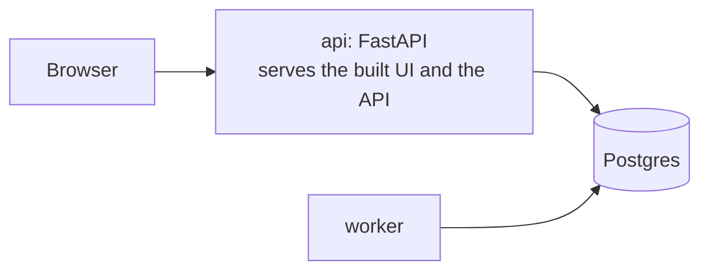

# Build plan: implement, test, evaluate

Nov 20, 2026. `docs/part-b-design.md` says what we build; this file says how: the order, the tests and CI. Patterns marked (kg) come from `~/dev/kg`, where they are already proven.

## 1. Ground rules

- **Every step ends the same way:** its gate is met, tests are green locally and in CI, and the work is committed and pushed. Commit messages are one line, with no AI attribution.
- **Python 3.12 everywhere** (local, the Docker image, CI), so tests run on the version that ships. In kg, Python 3.14 hid an import that 3.12 fails on. (kg)
- **Eval rows are read only by the eval run itself.** Dev excludes the 586 copies of eval rows.
- **Model calls are faked in automated tests.** The exceptions are the real-model e2e tests and the eval suites, which need keys and skip themselves without them.
- **Check real exit codes.** Never pipe test output without `set -o pipefail`: a pipe once hid 22 failing tests in kg. (kg)

## 2. Where it runs

Locally, with one command. Nothing runs in the cloud.

- **Three services** in `docker compose`: `db`, `api` and `worker`.
  - `api` serves the built Vite + React app at `/` and the API on the same origin, so no CORS and no separate web container.
  - In development, `pnpm dev` runs the Vite dev server with hot reload and forwards `/v1`, `/ui` and `/policies` to FastAPI.
- **One Postgres holds everything:** our tables and the LangGraph checkpoints.
- **Model keys stay on the server.** They live only in the `api` and `worker` environment.
- **Roles use demo tokens.** The UI's "acting as" menu (viewer, editor, two publishers) sends that role's token with each request, with no login page, cookie or accounts. The tokens are demo stand-ins for Cognito, listed in `.env.example`; they are not secrets. The marketplace API uses the same bearer-token check.
- **`langgraph.json`** registers the graph as `labeler`, but only for `langgraph dev` and Studio, for debugging one posting during the live session. Nothing depends on it.

**Who needs which key**

| To do this | Keys needed |
| --- | --- |
| Start everything; browse, edit and publish policies; run the test suites | None |
| Label postings live | `ANTHROPIC_API_KEY`. `TYPESAFE_API_KEY` is optional: without it, the Haiku screen runs instead of Jev |
| See traces and eval experiments in LangSmith | `LANGSMITH_API_KEY`, optional; a free account is enough |

## 3. Steps

### Step 0: repo and CI skeleton
- `git init -b main` in `~/dev/label`, a `.gitignore` (`.env`, `.venv`, `node_modules`, downloaded data), remote `phanhpp/labeling-agent`.
- `pyproject.toml`: uv, Python 3.12, ruff, pytest, pytest-asyncio.
- `.github/workflows/ci.yml` with the api job (lint, import check, pytest).
- **Gate:** CI is green on the first push.

### Step 1: foundations
- **Build:**
  - compose with Postgres 16;
  - `schema.sql`, applied at startup and safe to apply twice;
  - `scripts/load_data.py`: downloads the CSV once into `data/raw/` (git-ignored), loads postings, writes `data/splits.json` (eval ids, dev 300, Jev fit set, excluded copies);
  - `policies/v1.yaml` from the brief's text;
  - `app/policy.py`: load, validate, compute `model_hash` and `content_hash`, render the prompt parts and the Jev questions.
- **Tests:**
  - the split: 400, 100 fraud, 300 dev, no overlap, copies excluded, same result every run;
  - policy validation errors;
  - hashes: changing an effect keeps `model_hash`, changing text changes it;
  - the schema applies twice.
- **Gate:** eval ids verified, copies excluded.

### Step 2: core rules (pure functions, no models)
- **Build:** `clean`, the quote matcher, `check`, `decide`, the cache key.
- **Tests (table-driven):**
  - **Label rules:** one row per rule: §5 alone, unsure, a dropped quote making a section unsure, missing fields only, the injection floor, errors.
  - **Cleaning:** entities, non-breaking spaces, zero-width characters, hidden HTML, glued sentences.
  - **Quote matcher:** whitespace, curly quotes, re-slicing to the original text.
  - **Cache key:** it changes whenever any of its parts changes.
- **Gate:** every rule in design section 3.3 has a test.

### Step 3: agent
- **Build:**
  - `llm.py` model factory with the allowlist;
  - `escalate` with structured output;
  - the graph with screen `none`;
  - `eval/run_eval.py`: in-process, async, capped concurrency, writes `eval/runs/<run>/results.jsonl` and `summary.json`; flags `--split`, `--config`, `--limit`, `--gate`.
- **Then the screen:** Jev with kg's retry pattern, the Haiku screen, the regex lists and routing. Then `scripts/fit_cutoff.py`, and the checkpointer (`AsyncPostgresSaver`).
- **Tests (fake Jev, fake chat model):**
  - each route: cleared, escalate, injection floor, cache hit;
  - Jev retries: 529, 429, connection and timeout errors retried, 401 not (kg);
  - a run that crashes after the screen resumes without calling Jev again;
  - Anthropic client retries checked by injecting a 529.
- **Dev runs, the only place prompts may change:**
  1. `sonnet_only` on 30 posts, then on all 300;
  2. the Jev checks (two-run stability, per-section agreement, false clears);
  3. fit the cut-off;
  4. `jev_sonnet` and `haiku_sonnet` on the 300.
- **Gate:** quotes verify on dev; the cut-off clears at most 2% of dev fraud; errored runs are listed, never scored.

### Step 4: system
- **Build:**
  - the intake API with every API guardrail;
  - auth: bearer token → user, role, client, for both the marketplace and the UI's demo roles;
  - the queue: `SKIP LOCKED`, live before backfill before shadow, the reaper, attempts, the dead-letter label;
  - the worker: async, capped, 45 s per job;
  - the analyst read API and the stale-label read rule.
- **Tests (pytest against a real Postgres):**
  - every guardrail in design 7A;
  - idempotency, and a batch with one bad item accepted in part;
  - the deny-by-default route walk, and 404 for another client's posting;
  - no posting text in logs;
  - two workers never claim the same job;
  - a crash is picked up by the reaper and resumed;
  - the dead-letter label after 3 attempts.
- **Gate:** a posting sent to the API gets labeled end to end.

### Step 5: policy versions
- **Build:**
  - drafts, Test (shadow run plus flip report);
  - Publish: the four-eyes rule, the gate, the freeze trigger;
  - the re-label modes, rollback, stale reads;
  - `policies/v2.yaml` to `v4.yaml`;
  - `scripts/demo_versions.py`, which writes its run files into the repo.
- **Tests:**
  - the trigger rejects edits to a live version;
  - a publisher listed in `edited_by` is refused;
  - the mode is picked from the hashes: v4 re-decides with zero model calls;
  - the stale label is served until the re-label finishes;
  - rollback restores the old labels;
  - the "new policy disagrees" flag.
- **Gate:** v2, v3 and v4 each change labels with no code change, and v4 makes no model calls.

### Step 6: UI Tier 1
- **First:** two design options, as screenshots of static mockups, for your approval.
- **Build** the Vite + React + TypeScript app in `web/`, built into the `api` image: browse, the decision page, the policy editor, the "acting as" menu, which sends the chosen role's demo token.
- **Tests:**
  - **Vitest:**
    - highlight spans built from positions (overlapping quotes, field boundaries, text only);
    - filter state kept in the URL.
  - **Playwright** in Chromium, on the built app served by FastAPI, against a Postgres seeded from `tests/fixtures/` (stored labels, no model calls):
    - browse and filter;
    - open a decision and see each quote highlighted;
    - the role demo:
      - as viewer, editing is refused;
      - as editor, edit a draft and Test it; publishing is refused (role);
      - as a publisher who edited the draft, publishing is refused (four eyes);
      - as a publisher who didn't edit it, publishing works;
    - a posting containing `<script>` renders as text;
    - with the API down, the page shows an error, not an endless spinner.
  - **Visual check:** Playwright saves screenshots of every page at 1440 and 390 px wide. I review them myself and fix the layout before the step counts as done.
- **Gate:** Playwright green in CI, and screenshots reviewed.

### Step 7: evaluation and docs
- **Freeze:** git tag `eval-freeze`, then run the 400 once per core config.
- **`eval/report.py`** renders RESULTS.md from the run files: metrics with intervals, the confusion matrix, review load and its causes, cost, latency, the Jev checks, calibration, and the error analysis (5 to 10 errors, each with a category).
- **README:** setup in a few commands, running the app, the eval, the policy-change demo, the guardrail demo.
- **Fresh-clone check:** clone into a temporary folder, `cp .env.example .env`, `docker compose up`, then run the Playwright suite against it.
- **Gate:** the numbers in RESULTS.md match the run files, and the fresh clone works.

### Steps 8 to 10: optional
These are in design section 12: the cost cap; UI Tier 2 with the two extra configs; the demo without keys. The last is cheap by then, because step 6's seeder already loads committed files.

## 4. Test layers

| Layer | Tool | Needs | Runs |
| --- | --- | --- | --- |
| Rules, cleaning, policy, cache key, routing | pytest with fakes | nothing | every push |
| API, queue, worker, checkpointer | pytest | Postgres | every push |
| Web logic | Vitest | nothing | every push |
| Browser end to end | Playwright, built app | API + Postgres seeded from fixtures | every push |
| No keys at all | `docker compose up` with `.env.example` | Docker | every push |
| Real models end to end | pytest `-m e2e` | keys | by hand; skips without keys |
| Eval gate suites | `run_eval.py --gate` | keys | pull requests that touch the agent, policies or eval |

**Fakes, injected through the model factory:**
- a fake Jev that returns set answers or raises 529, 429 and timeouts (kg);
- a fake chat model that returns set findings.

## 5. Evaluation

- **Order:**
  1. Dev runs in step 3, where prompts, examples and the cut-off may change.
  2. The freeze.
  3. The 400 once per config in step 7.

  Nothing changes after reading eval results. Anything learned from them goes into RESULTS.md as a finding.
- **Files:** `eval/runs/<date>-<config>-<split>/results.jsonl` and `summary.json`. Each run is also a LangSmith experiment when a key is set.
- **Gate suites:**
  - **Suites:** edge cases, adversarial, policy change, and a 50-post dev sample.
  - **Pass marks:** in `thresholds.yaml`, set from a 3-run baseline, with zero slack on quotes, edge cases and injection.
- **Errored is not wrong.** A crashed run is listed with its error and left out of the scores, and the gate says "rerun". (kg)

## 6. CI

| Workflow | When | What |
| --- | --- | --- |
| `ci.yml`, job `api` | every pull request and push to `main` | uv on Python 3.12; import check with only the runtime dependencies (`uv sync --no-dev`), so the Docker image is complete (kg); ruff; `pytest -m "not e2e"` with a Postgres service |
| `ci.yml`, job `web` | same | `pnpm install --frozen-lockfile`, typecheck, Vitest, build, then Playwright against the API started in the job and a seeded Postgres. Traces and screenshots kept when it fails |
| `ci.yml`, job `no-keys` | same | Copies `.env.example` to `.env` and runs `docker compose up --wait`. Checks the API is healthy, a page renders, and a posting is accepted and shows "Live labeling off: no model keys" |
| `eval.yml` | pull requests whose latest push changed `app/agent`, `policies` or `eval` (kg's `changes` job) | Gate suites with secrets; results on the job page. Not a required check: an outage means rerun |
| `eval-full.yml` | by hand | The 400 for one config; results kept as an artifact |

**Every workflow:** a read-only token, and older runs on the same branch are cancelled. (kg)

**Branches:** one short-lived branch and pull request per step, merged when CI is green. This also triggers the eval gate.

## 7. Secrets and config

| Where | What |
| --- | --- |
| `.env.example` (committed) | Every variable, with no real secret. The demo tokens per role (viewer, editor, two publishers, marketplace) have obvious demo values |
| Local `.env` | `ANTHROPIC_API_KEY`, `TYPESAFE_API_KEY`, optional `LANGSMITH_API_KEY` (tracing), optional `DAILY_BUDGET_USD` |
| GitHub secrets | `ANTHROPIC_API_KEY`, `TYPESAFE_API_KEY`, `LANGSMITH_API_KEY`, used by the eval workflows only |

## 8. Lessons from kg applied here

- Python 3.12 in tests, the image and CI.
- An import check with runtime dependencies only.
- Jev retries on 5xx, 429, connection and timeout errors.
- Errored is not wrong.
- `pipefail`.
- Test an outage path, not just the happy path: "API down shows an error".
- Treat server data as untrusted in the UI.
- Read-only CI tokens.
- An eval workflow that runs only when the agent changed.
