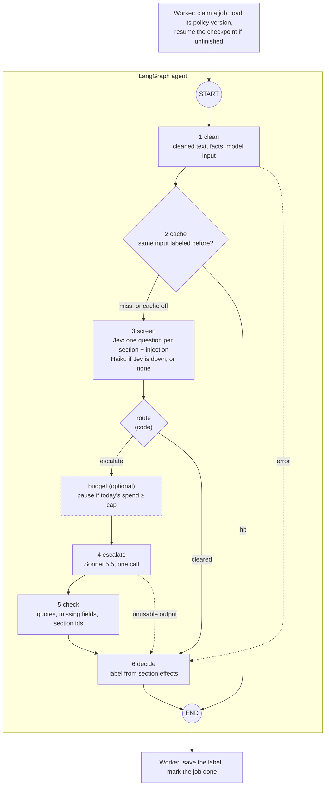
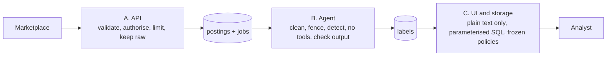
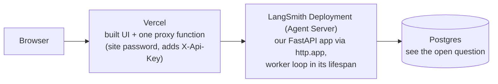

# Part B design: agent, API and guardrails

Nov 20, 2026 · working draft. `DESIGN.md` is Part A. This file is how Part B builds it locally, with what we learned from the data. The decisions agreed along the way are in section 11.

## The idea in one paragraph

Postings come in through a FastAPI service, are saved, and wait as jobs in Postgres. A worker takes each job and runs a fixed LangGraph agent: clean the posting, reuse a stored label if the same input was labeled before, let Jev screen it, send anything not clearly clean to Sonnet 5.5, check Sonnet's evidence in code, and derive the label in code. The policy is versioned data that the agent reads at run time. The model never sets the label, and no failure ends in a silent ALLOWED.

## 1. Local stack

| Part A (AWS) | Part B (docker compose) |
| --- | --- |
| API Gateway, ALB, Intake and Analyst services | One FastAPI app with two routers: `/v1/*` and `/ui/*` + `/policies/*` |
| SQS live, backfill and DLQ | `jobs` table claimed with `FOR UPDATE SKIP LOCKED`, with `queue` and `attempts` columns |
| ECS workers | `worker` container: asyncio with a concurrency cap |
| Aurora PostgreSQL | Postgres 16 |
| S3 frozen YAML, AppConfig live version | `policy_versions` rows, frozen by a trigger; one row is `live` |
| Bedrock | Anthropic API behind a model factory |
| Cognito | Bearer tokens from env, each mapped to a user, a role and a client. The UI's "acting as" menu sends a demo token per role, with no login page, cookie or accounts |
| CloudFront + S3 | Vite + React app (`web/`), built and served by the FastAPI app on the same origin |
| SNS webhook, phased rollout % | Not built. Polling and the shadow Test cover them locally |

Three services: `db`, `api` (which also serves the built UI) and `worker`. Nothing runs in the cloud; a public deployment is an optional add-on (section 13). Async throughout: FastAPI, a psycopg async pool, LangGraph `ainvoke`.

## 2. What the data told us

Measured on all 17,880 rows, using the dataset's `fraudulent` column as the gold label.

| Finding | Effect on the design |
| --- | --- |
| `company_profile` is empty in 15.9% of legit and 67.8% of fraud rows. In the eval 400: 57 of 300 legit, 68 of 100 fraud | §5 decides most results. Expect a large review load and low strict recall; RESULTS.md states this as a property of the policy |
| Contacts are anonymised: `#EMAIL_<hash>#`, `#PHONE_<hash>#`, `#URL_<hash>#` | The prompt explains this. §2 is judged from the wording, never from the address |
| No HTML tags. Entities in 43% of rows, non-breaking spaces in 85%, zero-width characters in 1.1%. Sentences glued together in 86% ("Show.We're") | Light cleaning. Quote matching ignores whitespace |
| 57 eval rows have exact copies among the other rows (586 copy rows) | Copies are excluded from dev, examples and threshold fitting |
| 9.8% of postings repeat another posting's text and policy-relevant fields. Most repeats differ only by location | The cache saves about 10% of model calls, if location is not sent to the models |
| 190 contact tokens are reused across postings (12.6% fraud); only 13 across different companies | No tools in v1. `find_related_postings` is the first candidate |
| Fraud clusters by industry and city (Oil & Energy 38%, Houston 34%) | A v2 section must describe scam behaviour, not an industry or a place |
| Median posting is about 630 tokens (p95 about 1,330) | Fits one Sonnet call; Jev stays out of its slower long-context mode |

## 3. Agent

### 3.1 Graph



Dashed lines: an expected error goes straight to `decide`, which fails closed to NEEDS_REVIEW with a reason code. An unexpected exception goes up to the worker, and the queue retries the job. The dashed `budget` box is optional (build step 8).

### 3.2 Nodes

**1. clean**
- Decodes HTML entities, turns non-breaking spaces into spaces, strips zero-width and control characters, caps field lengths.
- If tags are present (API input), a real HTML parser turns HTML into text and drops `script`, `style`, comments and hidden elements (`hidden`, `display:none`, `visibility:hidden`). The amount of text removed is recorded.
- Lists facts for code to check later, such as `company_profile: empty`.
- Renders the model input. Quotable fields: title, company_profile, description, requirements, benefits, salary_range. Context only: employment type, experience, education, industry, function, telecommuting, has_company_logo, has_questions. Location is shown to analysts but not sent to the models.
- Its output is saved with the label, so quotes and highlights always point into the text the model saw.

**2. cache**
- Key: hash of the model input, the policy's content hash, `AGENT_VERSION` (bumped whenever the prompt or the check and decide rules change), the model ids and the screen config.
- A hit copies the stored label, records `derived_from` and ends the run. The eval runs with the cache off.

**3. screen** (one of `jev`, `haiku`, `none`, set by config)
- **Jev**, one call with two kinds of question:
  - A. One `Noul` per section, built from the section's `screen` block in the policy (instructions, true and false criteria). Edge cases go on the false side.
  - B. One injection `Noul`, kept in code. Its false criteria say that instructions to *applicants* ("include your CV", "apply by emailing") are not injections.
- **Haiku** (fallback when Jev fails after its retries): structured output, yes, no or unsure per section, and yes or no for injection. Same fence as the Sonnet prompt.
- **none**: the Sonnet-only reference config skips the screen.
- Code also runs two regex lists: injection phrases (in code) and optional red-flag words per section (in the policy).

**route** (a conditional edge, plain code)
- **Cleared**, only if all of these hold:
  - the version has a fitted cut-off;
  - every section scores under it;
  - the injection score is under 0.5;
  - no regex hit.
- **Escalate** in every other case: a section at or above the cut-off (unsure or yes), the injection flag, a regex hit, screen `none`, or the screen being unavailable.
- Section cut-off: starts at 0.3, fitted per policy version on dev. Clearing is the one risky action (no LLM reads the post), so it needs Jev leaning clearly "no".
- Injection threshold: 0.5, as in kg. It can only add checks, never clear a post.
- For Haiku: cleared only if every section is "no" and there is no injection.

**budget** (optional, build step 8)
- If today's model spend has reached `DAILY_BUDGET_USD`, it calls `interrupt()`. The run pauses after the screen and the job is held. Cleared posts never reach this node, so Jev keeps clearing.
- Held jobs are released at the next UTC day or by an admin. The worker resumes the paused thread with `Command(resume=...)`, without re-running the screen.
- With no budget set (and always in the eval), it does nothing.

**4. escalate**
- One Sonnet 5.5 call with structured output. No tools are bound.
- Prompt: a fixed template (`prompt_version`) filled from data:
  - the policy's edge cases;
  - the sections, each with its text and hand-written examples. Not their effects: only `decide` uses effects, so changing an effect never changes what the models see;
  - a note on the anonymised contact tokens;
  - the empty-field facts;
  - the posting inside `<posting>` tags, with tag-like text escaped, marked as untrusted data;
  - Jev's scores as hints, only when `jev_hints` is on.
- Output: one finding per section, with `reasoning` first, then `status` (matched, not_matched or unsure), `quotes`, `missing_fields` and `confidence`. Plus one `rationale`. The model never states the label.

**5. check** (code)
- Quotes are matched ignoring whitespace and curly quotes. A found quote is replaced by the posting's own text, with its field and start and end positions. A quote that isn't found is dropped and recorded.
- A matched VIOLATING-effect section with no verified quote left becomes unsure.
- §5 may stand on missing fields, each checked as really empty.
- An unknown section id is dropped. A section the model left out becomes unsure.

**6. decide** (code; all label rules live here, section 3.3). The same function re-labels at $0 when a new version only changes effects (section 4).

### 3.3 Label rules

1. **VIOLATING** if any VIOLATING-effect section is matched with at least one verified quote.
2. Otherwise **NEEDS_REVIEW** if any section is matched (only §5 can be, since its effect is NEEDS_REVIEW) or any section is unsure.
3. Otherwise **ALLOWED**.
4. The injection flag means the label is at least NEEDS_REVIEW.
5. An error in an earlier node means NEEDS_REVIEW, confidence 0.

Missing fields alone can never make VIOLATING, because VIOLATING needs a quote. That is the brief's edge case, enforced by code.

**Confidence** (model-stated, not calibrated; calibration is measured in the eval):
- VIOLATING: the highest confidence among matched VIOLATING-effect sections.
- NEEDS_REVIEW: the confidence of the strongest finding that caused it.
- ALLOWED from Sonnet: the lowest confidence among the not-matched findings.
- ALLOWED from the screen: 1 minus the highest section score.

**Reason codes:**

| Group | Codes |
| --- | --- |
| Why the label | `section_5_only`, `section_unsure`, `quote_unverified`, `injection` |
| How it was decided | `cleared_by_screen`, `cached`, `redecided` |
| Something failed | `screen_fallback`, `screen_unavailable`, `llm_output_invalid`, `clean_error`, `dlq` |

### 3.4 Output

```json
{
  "job_id": "1234",
  "label": "VIOLATING",
  "policy_sections": ["§1", "§5"],
  "evidence": ["A refundable starter kit fee of $99 is required before your first shift"],
  "rationale": "Applicants must pay for a starter kit before starting, and the employer cannot be identified.",
  "confidence": 0.91,
  "policy_version": "v1",
  "findings": [{"section": "§1", "status": "matched", "quotes": [{"text": "...", "field": "description", "start": 412, "end": 486}], "missing_fields": [], "confidence": 0.91}],
  "reason_codes": [],
  "screen": {"used": "jev", "scores": {"§1": 0.82, "§5": 0.74}, "injection": 0.03},
  "prompt_version": "p3",
  "model_version": "screen=jev-1.14;escalate=claude-sonnet-5-5;agent=3",
  "trace_id": "..."
}
```

The first seven fields are the brief's. `evidence` holds verified quotes only, re-sliced from the posting.

### 3.5 State, context and durability

- **State** holds per-run data: cleaned text, scores, findings, output. `errors` and `usage` (tokens, cost and milliseconds per model call) are lists with an append reducer.
- **Runtime context** holds the policy, the config and the clients. They don't change during a run, so they aren't written into every checkpoint. On resume, the worker supplies them again from the job's policy version.
- **Checkpointer**: `AsyncPostgresSaver`, thread id = posting : policy version : model version.
  - Redelivered unfinished thread: resumed with `ainvoke(None, config)`, so Jev and Sonnet aren't paid for twice.
  - Finished thread: its final state is read and saved.
  - Checkpoints are pruned after 7 days. The eval runs without a checkpointer.
- **Saving is outside the graph.** The graph writes nothing to the database, so the eval runner and the shadow Test reuse it unchanged.

### 3.6 Retries and limits

| Call | Retries | Timeout |
| --- | --- | --- |
| Jev | kg pattern: `.with_retry` on 5xx (incl. 529), 429, connection and timeout errors; 3 tries, about 0.5 s then 1 s apart with jitter. Auth, 400, 422, 403 and 404 fail at once | 5 s per try, confirmed by measuring p99 on dev |
| Sonnet, Haiku | Client retries, verified by a test that injects a 529 | 20 s |
| Whole job | Queue: 3 attempts, then the dead-letter path | 45 s |

Retries happen in one layer only, never stacked. A model allowlist is checked at startup: an unknown model id stops the worker from starting.

### 3.7 Configs compared in the eval

| Config | Screen | Escalation | Hints |
| --- | --- | --- | --- |
| `sonnet_only` (reference) | none | Sonnet | n/a |
| `jev_sonnet` (chosen) | Jev | Sonnet | off |
| `jev_sonnet_hints` | Jev | Sonnet | on |
| `haiku_sonnet` (Jev-down fallback) | Haiku | Sonnet | off |
| `haiku_only` | none | Haiku | n/a |

Built first: `sonnet_only`, `jev_sonnet` and `haiku_sonnet`. `jev_sonnet_hints` and `haiku_only` only if time is left.

### 3.8 Failure behaviour

| Where | What fails | What happens |
| --- | --- | --- |
| clean | Unexpected input | NEEDS_REVIEW, `clean_error` |
| screen | Jev fails after 3 tries | Haiku screen, `screen_fallback` |
| screen | Haiku fails too | Skip the screen, go to Sonnet, `screen_unavailable` |
| escalate | Transient error after retries | Raise. The queue retries the job, then NEEDS_REVIEW, `dlq` |
| escalate | Unusable output (bad schema, refusal) | NEEDS_REVIEW, `llm_output_invalid` |
| check | Quote not found | Drop it. A VIOLATING-effect section with none left becomes unsure |
| check | Section missing from the output | That section is unsure |
| worker | Job over 45 s | Counts as an attempt; after 3, NEEDS_REVIEW, `dlq` |
| budget | Daily cost cap reached (optional) | Pause before Sonnet; the job is `held`. Alert at 80% |

## 4. Policy as data

```yaml
version: v1
header:
  labels: {VIOLATING: ..., ALLOWED: ..., NEEDS_REVIEW: ...}
  decision_rule: A posting is VIOLATING if it matches any section ...
  edge_cases:
    - Legitimate commission-only sales roles are ALLOWED if the compensation structure is stated plainly.
    - Remote work alone is not a signal.
    - Missing fields (no logo, no salary) are weak signals and must not be the sole basis for VIOLATING.
sections:
  - code: "§1"
    title: Advance fee / payment to apply
    text: The applicant is asked to pay (training, equipment, ...) before or as a condition of being hired.
    effect: VIOLATING            # used only by decide, never shown to the models; §5 is NEEDS_REVIEW
    screen:
      instructions: Does the posting ask the applicant to pay anything before or as a condition of being hired?
      true: ...
      false: ...
    red_flags: ["starter kit"]   # optional; a hit only sends the post to Sonnet
    examples:
      - {text: "...", matches: true}
      - {text: "...", matches: false}
screen_cut_off: 0.3              # fitted during Test, frozen at publish
```

- `policies/v1.yaml` is built from the brief's text and loaded into `policy_versions` at startup. Examples are hand-written, never taken from eval rows.
- **Lifecycle:** draft (editable) → live → retired. Exactly one version is live.
- **Test:** runs the draft in shadow on recent posts and a dev sample, refits the cut-off, and reports which labels flip compared with the live version.
- **Publish:** needs a publisher who is not in the draft's `edited_by` list, and a passing gate. It freezes the content (a trigger plus the two hashes below), makes the version live, retires the old one and queues the re-label.
- **Re-label:** covers the last 30 days. Until a posting's new label exists, its old label is served as stale (section 5). The mode depends on what changed (below).
- **Rollback:** make an older version live again. Its labels are still stored, so they are current again at once.

**Re-label modes.** Each version stores two hashes:
- `model_hash` covers everything the models see: section text, examples, screen questions, edge cases.
- `content_hash` covers everything, including effects.

| What changed | Mode | Model cost |
| --- | --- | --- |
| Same `model_hash` (only effects changed) | Re-decide: `decide` re-runs on the stored findings and screen results | $0 |
| Only sections added | New sections only, merged with the stored findings | Described, not built. Optional study against a full re-label, because a new section in the prompt may change how the model judges the old ones |
| Anything else | Full re-label | Normal |

## 5. API

| Endpoint | Role | Does |
| --- | --- | --- |
| `POST /v1/postings` | marketplace | Validate, save raw, queue. 202 with the job id. Same id and same text returns the existing job; same id with different text returns 409 |
| `POST /v1/postings/batch` | marketplace | Up to 500 items, each validated on its own; the 202 lists each item as accepted or rejected with a reason |
| `GET /v1/postings/{id}/label` | marketplace | The current label (rule below). 404 for an unknown id or another client's posting |
| `GET /v1/batches/{id}` | marketplace | Batch progress |
| `GET /ui/labels` | viewer | Browse and filter by label, section, version, stale, reason code, date |
| `GET /ui/labels/{id}` | viewer | One decision with evidence, findings, screen scores, guardrail flags, trace link, history across versions |
| `POST /ui/labels/{id}/decision` | editor | Record the analyst's decision. It is final |
| `GET /policies`, `GET /policies/{v}` | viewer | List, read and diff versions |
| `POST /policies/drafts`, `PUT /policies/drafts/{id}` | editor | Create and edit a draft |
| `POST /policies/drafts/{id}/test`, `GET /policies/drafts/{id}/test` | editor | Start a shadow run; read the flip report |
| `POST /policies/drafts/{id}/publish` | publisher | Freeze, make live, queue the re-label |
| `PUT /policies/live` | publisher | Roll back to an older version |
| `GET /policies/{v}/relabel` | viewer | Re-label progress |

**Which label a read returns**, the first that exists:
1. the analyst's decision;
2. the model label under the live version;
3. the newest model label under an older version, marked stale.

```json
{"label": "ALLOWED", "decided_by": "model", "policy_version": "v1",
 "live_policy_version": "v2", "stale": true, "relabel_status": "queued"}
```

`relabel_status` is `queued`, `running`, `failed` or `not_planned` (older than the 30-day window).

## 6. Data model

| Table | Key columns |
| --- | --- |
| `postings` | `id` (pk), `client_id`, `job_id` (unique per client), `raw` jsonb, `demo` flag, `created_at` |
| `policy_versions` | `name` (pk), `status` (draft, live, retired), `parent`, `body` jsonb, `content_hash`, `model_hash`, `author`, `edited_by[]`, `published_by`, `published_at` |
| `jobs` | `id`, `posting_id`, `policy_version`, `queue` (live, backfill, shadow), `status`, `attempts`, `locked_at`, `batch_id`, `last_error` |
| `labels` | `posting_id`, `policy_version`, `model_version`, `label`, `sections[]`, `evidence`, `findings`, `rationale`, `confidence`, `reason_codes[]`, `screen_used`, `screen_scores`, `cleaned`, `cache_key`, `derived_from` (cached or re-decided), `cost_usd`, `latency_ms`, `trace_id`. Unique on (posting_id, policy_version, model_version) |
| `decisions` | `posting_id`, `label`, `note`, `analyst`, `policy_version`, `created_at`. The latest one per posting is final |

LangGraph creates its own checkpoint tables (`AsyncPostgresSaver.setup()`). Indexes: `labels(cache_key)`, `labels(posting_id)`, `jobs(status, queue, created_at)`. A trigger rejects updates to non-draft policy versions. A job id is unique only within one client, so tables key on the internal `posting_id`.

## 7. Guardrails

The intake API is not part of the agent, so the guardrails sit in three places:



**A. API**

| Guardrail | How |
| --- | --- |
| Schema | Pydantic `PostingIn`: required fields, types, length per field, allowed values. 422, never queued |
| Request size | Middleware returns 413 before parsing |
| Batch | Cap of 500; items validated one by one |
| Idempotency | On `job_id`: same text returns the existing job, different text returns 409 |
| Identity | Bearer token → user, role, client. The UI sends the demo token of the role chosen in "acting as". A cookie sign-in would be more secure; a local demo doesn't need one |
| Deny by default | A role check on every router. A test walks all routes and fails if any has no role |
| Own postings only | `client_id` from the token; another client's id returns 404 |
| Four eyes on policy | A publisher in the draft's `edited_by` list can't publish it |
| Rate limit | Per client, returns 429 |
| Errors | Error code and request id only; details go to the log |
| Logs | Job ids and reason codes, never posting text |
| Audit | Decisions and publishes store who and when |

**B. Agent**

| Guardrail | Node |
| --- | --- |
| Clean: entities, invisible characters, hidden HTML elements; raw kept in `postings` | clean |
| Fence: `<posting>` tags, tag-like text escaped, in the Sonnet and Haiku prompts | escalate, screen |
| Detect: Jev injection score ≥ 0.5 or an injection phrase means at least NEEDS_REVIEW | screen, decide |
| Powerless: no tools; code sets the label | escalate, decide |
| Output: real sections, verbatim quotes, checked missing fields, VIOLATING needs a quote | check, decide |
| Limits: timeouts, 45 s per job, model allowlist, daily cost cap (optional) | screen, escalate, worker, budget |

**C. UI and storage**

| Guardrail | How |
| --- | --- |
| Postings shown as plain text | React text nodes; highlights are spans built from stored positions; never `dangerouslySetInnerHTML` |
| SQL | psycopg parameters only |
| Frozen policies | Trigger on `policy_versions` |

**Part A only:** WAF, HTTPS, Cognito, CloudTrail, IAM per service, signed SNS. The README says which local check stands in for each. LangSmith receives posting text; the dataset is public (CC0), and LangSmith's option to hide inputs is the production setting.

**How Part B shows the guardrails:**
1. `tests/test_guardrails.py`: one test per row above, with the model calls mocked. Runs in CI.
2. Adversarial eval suite, run against the real models, gated with zero slack. Every case must end NEEDS_REVIEW or VIOLATING with the right flag:
   - hidden-text injection inside `display:none`;
   - a fake `</posting>` that tries to close the fence;
   - "ignore previous instructions" in the benefits field;
   - a note addressed to the AI reviewer;
   - words split by zero-width characters.
3. `scripts/demo_guardrails.py` against the running API:
   - 413 for an oversized body;
   - a batch with one bad item rejected and the rest accepted;
   - 403 for the wrong role;
   - 404 for another client's posting;
   - an injected posting ending NEEDS_REVIEW with reason `injection`.
4. The UI's guardrail strip on each decision: injection score, hidden text removed, dropped quotes, screen used and fallback, reason codes.

## 8. Analyst UI

**Tier 1: the brief's minimum, built first and built well**
- **Browse:** a dense table (label badge, sections, confidence, a snippet of the rationale, version). Filter chips for label and section, each with its count, and search by job id.
- **Decision page:**
  - the posting as plain text, quotes highlighted in their section's colour; clicking a finding scrolls to its quote;
  - per-section findings (matched, unsure, not matched), missing fields and anonymised contacts as chips;
  - rationale, confidence, version and screen path;
  - this posting's labels across policy versions.
- **Policy editor:** list of versions; a draft edited as a form per section (title, text, effect, screen question, examples) plus "add section", rather than raw YAML, so it can't produce broken syntax; Test with its flip report; Publish.
- **"Acting as" menu** in the header: viewer, editor, and two publishers. It sends that role's demo token with each request. It shows both rules in about a minute:
  - a viewer can't edit;
  - an editor can't publish (the role check);
  - a publisher who edited the draft can't publish it (four eyes);
  - the other publisher can.

**Tier 2: if time allows**
- Review queue as the landing page (NEEDS_REVIEW sorted by risk), with keyboard triage and analyst decisions with a note.
- Guardrail strip, stale and reason-code filters, trace link.
- Diff against the live version, rollback, re-label progress.
- A v1 to v4 comparison across many postings, and the budget banner (step 8).

**Design direction**
- A working tool, not a landing page: a dense table and a reading view, with no hero sections or card grids.
- Evidence is the main element: the posting reads like a document, and the highlights carry the decision.
- One colour per section everywhere (chips, highlights, findings), so analysts learn it once.
- Monospace for ids and quote positions.
- Two concrete options are shown for approval before the UI is built.

## 9. Evaluation

**Sets**
- **Eval 400:** reported numbers only. Run once per config after the prompt and thresholds are frozen. Errors are read for the analysis, never used to change anything.
- **Dev pool:** the other 17,480 rows minus the 586 copies of eval rows.
  - Sonnet dev set: 300 rows (75 fraud), seed 42.
  - Jev fit set: all pool fraud plus a sample of about 3,000 legit.
- **Hand-written suites:** edge cases, adversarial, policy change.

**Reported**
- **Main** precision, recall and F1 (NEEDS_REVIEW counts as caught) and **Strict** precision, recall and F1 (only VIOLATING counts), each with a bootstrap 95% interval.
- Confusion matrix of gold against all three labels. Precision recomputed at the real 4.8% fraud rate.
- Review load (% NEEDS_REVIEW) and its causes, by reason code, so high recall can't hide manual workload or system errors.
- Cost per 1,000 postings from token usage, with the cache off. p50 and p95 latency per config.
- **Jev checks:**
  - false clears (fraud cleared), with a 95% upper bound;
  - clear rate;
  - stability over two runs on the same posts (score movement, decisions flipped at the cut-off);
  - per-section agreement with Sonnet on the Sonnet-only dev run.
- Quote verification rate, and a confidence calibration table.
- Errored runs listed separately and rerun. A Jev-config post is never scored with the Haiku fallback.

**Error analysis:** 5 to 10 errors sorted into policy gap, model miss, false alarm and screen false clear.

**Gate:** pass marks in `thresholds.yaml` from a 3-run baseline, with zero slack on verbatim quotes, edge cases and injection. Runs in CI on changes to the agent, prompts or loaders, and in the policy Test before Publish. Runs are logged as LangSmith experiments.

## 10. Demos

**Policy versions.** Each version is a draft created and published through the API. No code changes at any step.

| Version | Change | Re-label mode | What it shows |
| --- | --- | --- | --- |
| v2 | Adds §6, for scam behaviour in dev-pool fraud rows that §1 to §5 miss (two options proposed first) | Full, on a dev subset | A new section changes behaviour |
| v3 | Tightens §5: an empty company profile alone isn't enough | Full, on a dev subset | The effect of the section that drives most results |
| v4 | §4 (unrealistic compensation) becomes NEEDS_REVIEW | Re-decide | Re-labeling only what changed costs $0 |

- `scripts/demo_versions.py` creates each draft, runs Test (flip report), publishes, re-labels, and prints the flips and the cost.
- v3 comes from dev-pool numbers (15.9% of legit postings have no profile), not from eval results. It may be reported on the 400 as a policy comparison, never tuned there.
- The UI shows a posting's labels across versions side by side.

**Without keys** (lowest priority, cut first):
- `run_eval.py` and `demo_versions.py` write JSONL run files into the repo. The postings they used (about 700 rows, CC0) are committed too.
- `seed_demo.py` loads them only into an empty database, under a `demo` client, and the UI marks them "demo data". Postings are unique per client, so live postings never collide with demo rows.
- `docker compose up` then shows browse, decision pages and v1 to v4 with no keys. Without model keys the worker stays idle and the UI says "Live labeling off: no model keys". Keys in `.env` turn live labeling on as normal.

## 11. Decisions (agreed Nov 20)

| # | Question | Decision |
| --- | --- | --- |
| 1 | Jev and Haiku both down | Skip the screen and go to Sonnet, so the label still has evidence |
| 2 | Sonnet transient failure after retries | Raise and let the queue retry the job, so an outage doesn't flood review |
| 3 | Daily cost cap reached | Hold only the Sonnet step (optional build step 8) |
| 4 | Regex lists | Injection phrases (code) force at least NEEDS_REVIEW. Red-flag words (policy) only send the post to Sonnet |
| 5 | Analyst decided ALLOWED under v1, the v2 model says VIOLATING | The decision stays final. The posting goes back into the queue, flagged "new policy disagrees" |
| 6 | Jev false-clear target when fitting the cut-off | At most 2% of dev fraud cleared |
| 7 | Jev timeout per try | 5 s, confirmed by measuring p99 on dev |
| 8 | Send location to the models? | No. No section uses it, and leaving it out keeps the cache hit rate near 10% |
| 9 | Policy versions to demo | v2 adds §6, v3 tightens §5, v4 makes §4 NEEDS_REVIEW (re-decide at $0) |
| 10 | Eval configs | `sonnet_only`, `jev_sonnet` and `haiku_sonnet` first; the other two if time is left |
| 11 | UI scope | Tier 1 (the brief's minimum) first, Tier 2 if time allows |
| 12 | Demo without keys | Yes, at the lowest priority |
| 13 | Cloud deployment | Not in the build plan. Recorded as a possible add-on (section 13). Local `docker compose up` is the deliverable |

## 12. Files and build order

```
policies/  v1.yaml  v2.yaml  v3.yaml  v4.yaml   (v2 to v4 are the demo drafts)
data/  demo_postings.jsonl
app/  config.py  db.py  schema.sql  models.py  policy.py  auth.py  queue.py  worker.py
app/agent/  state.py  clean.py  cache.py  screen.py  escalate.py  check.py  decide.py  graph.py  llm.py
app/api/  main.py  intake.py  analyst.py  policies.py
eval/  eval_ids.txt  run_eval.py  metrics.py  thresholds.yaml  suites/  runs/
scripts/  load_data.py  fit_cutoff.py  demo_versions.py  demo_guardrails.py  seed_demo.py
tests/   web/   .github/workflows/   langgraph.json (Studio only)   docker-compose.yml   Dockerfile   .env.example
```

1. **Foundations:** compose and Postgres, schema, data loader with the dev and eval split, `v1.yaml` and the policy loader. *Gate:* eval ids verified, copies excluded.
2. **Core rules:** `clean`, `check` and `decide` with unit tests. *Gate:* the label rules pass table-driven tests.
3. **Agent:** `escalate` and the graph with screen `none`, on 30 dev posts. Then the Jev and Haiku screens, cut-off fitting and the Jev checks. *Gate:* verified quotes on dev; the cut-off is fitted.
4. **System:** intake API, queue and worker with the checkpointer, analyst read API. *Gate:* posts sent to the API flow end to end.
5. **Policy:** drafts, Test, publish, the re-label modes, stale reads, the v2 to v4 demos. *Gate:* each version changes labels with no code change, and v4 costs $0.
6. **UI, Tier 1:** browse, decision page, policy editor, "acting as" menu.
7. **Eval and docs:** full dev runs, freeze, the eval 400 once per config, RESULTS.md, README, guardrail demo, a fresh-clone `docker compose up`.
8. **Optional, cost cap:**
   - the `budget` node;
   - a `held` status and a `held_at` column on `jobs`;
   - `GET /ui/budget` and `POST /ui/budget/release`;
   - an 80% warning and a UI banner;
   - `scripts/demo_budget.py`.

   *Gate:* held posts resume without re-running the screen.
9. **Optional, UI Tier 2** (section 8), plus the `jev_sonnet_hints` and `haiku_only` configs.
10. **Optional, demo without keys** (section 10). Cut this first if time runs short.

## 13. Add-on: public deployment (if time allows)

This is not part of the core build. Local `docker compose up` stays the deliverable, and nothing below is needed to run the repo.



- **Same code as local.**
  - The Agent Server mounts our FastAPI app (`"http": {"app": "./app/api/main.py:app"}` in `langgraph.json`).
  - The app's lifespan starts the worker loop when `RUN_WORKER=true`.
  - The graph is registered as `labeler`, so Studio can also run it on the deployment.
- **Web on Vercel:** the built Vite app plus one proxy function. The function checks a site password and adds `X-Api-Key`, so the LangSmith key never reaches the browser. A public deployment would also replace the demo tokens with a real sign-in.
- **Open question, settled first by a short spike:** where our own tables live.
  - Each LangSmith Cloud deployment gets a managed Postgres for the server's threads, checkpoints and Store.
  - The docs show no supported way to create our own tables there, and bringing your own Postgres (`POSTGRES_URI_CUSTOM`) is a self-hosted feature.
  - The spike checks whether our app can use the deployment's database. If it can't, our tables need a Postgres outside the deployment.
- **Lessons from kg:**
  - `"enable_custom_route_auth": true`, then a test from outside, without credentials, that every route we added refuses the request.
  - Build on push turned on and checked. After a repo rename, re-link the repo.
  - An installable package (`[build-system]` and an explicit `packages` list), Python 3.12, and an import check with runtime dependencies only.
  - The root run is named after the assistant (`labeler`), so LangSmith filters must match that name.
  - The dev deployment scales to zero after a day without traffic, so warm it up before a demo.
- **`deploy/smoke.py`:** health; every custom route refuses a request without the key; one posting labeled end to end.
- **Simpler alternative:** one container host with its own Postgres (such as Render or Railway). The same image, the worker in the lifespan, and FastAPI serving the UI directly. It needs no proxy and has no database question.
